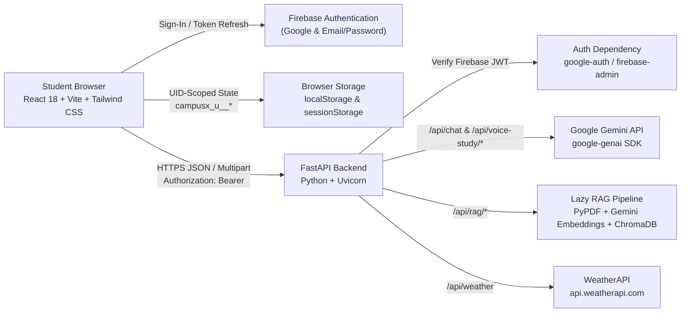
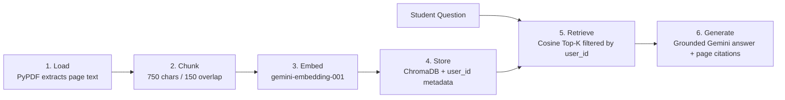

# CampusX: AI Student Hub


**CampusX: AI Student Hub** is a full-stack, AI-powered student productivity platform designed for college students. Built with **React**, **Vite**, **Tailwind CSS**, **Python FastAPI**, **Firebase Authentication**, **Google Gemini**, **ChromaDB**, and **WeatherAPI**, it combines grounded PDF study assistance (RAG), conversational AI tutoring, voice-to-timetable planning, smart note-taking, exam quizzes, live weather lookup, and a customizable student portfolio inside one authenticated workspace.

---

## Table of Contents

- [Project Overview](#project-overview)
- [Key Features](#key-features)
- [Technology Stack](#technology-stack)
- [System Architecture](#system-architecture)
- [RAG Workflow](#rag-workflow)
- [Project Structure](#project-structure)
- [Installation and Local Setup](#installation-and-local-setup)
- [Environment Variables](#environment-variables)
- [API Documentation](#api-documentation)
- [Deployment Guide](#deployment-guide)
- [Screenshots](#screenshots)
- [Three Real-World Business Use Cases](#three-real-world-business-use-cases)
- [Bug Identification and Fix](#bug-identification-and-fix)
- [Future Improvements](#future-improvements)
- [Author and Contact Information](#author-and-contact-information)
- [GitHub Repository and Live Website Links](#github-repository-and-live-website-links)

---

## Project Overview

### Problem Statement
Engineering and university students routinely switch between separate apps to read lecture PDFs, organize revision notes, build exam schedules, practice MCQs, maintain personal portfolios, and ask AI study questions. Standard AI chat tools also suffer from two practical drawbacks in academic workflows:
1. **Unverified Answers**: General-purpose chatbots often hallucinate details instead of answering strictly from a student's own syllabus or lecture notes.
2. **Client-Side Secret Exposure**: Prototype web apps sometimes call third-party APIs directly from browser JavaScript, risking API key leaks.

### Purpose & Target Users
CampusX solves these issues for **B.Tech / university students and self-learners** by providing:
- **Authenticated User Isolation**: Firebase Authentication separates each student's local workspace (`campusx_u_<uid>_*`) and backend RAG vector data (`user_id` metadata filtering in ChromaDB).
- **Grounded Document Q&A (RAG)**: Extracts text from uploaded PDFs, embeds passages using Gemini Embeddings, stores them in ChromaDB, and produces answers with page-number citations.
- **Voice-First Study Planning**: Converts spoken exam requirements (English or Hindi) into time-slotted timetables and structured chapter notes.
- **Server-Side API Security**: Routes all Google Gemini and WeatherAPI requests through FastAPI endpoints so private keys never appear in client bundles.

---

## Key Features

| Feature | Implemented Capabilities |
|---|---|
| **Firebase Authentication & Account Isolation** | Google Sign-In (`prompt: select_account`), Email/Password Sign-In & Registration, Forgot Password email reset, Remember Me persistence (`local` vs `session`), protected `/login` and `/register` gates, and backend bearer-token verification on private endpoints. |
| **AI Personal Portfolio** | Editable student profile (name, headline, location, avatar URL, bio, email, phone, skills, programming languages, education, and projects) persisted per Firebase UID in browser `localStorage`, plus reset-to-default support. |
| **Custom GitHub, LinkedIn & Personal Website Links** | Optional profile URLs inside **Edit Profile** with client-side protocol (`http://` / `https://`) and domain validation for GitHub (`github.com`) and LinkedIn (`linkedin.com`), inline remove buttons, zero hardcoded sample links, and safe new-tab rendering (`target="_blank" rel="noopener noreferrer"`). |
| **AI Chatbot** | Multi-turn academic tutor powered by Google Gemini (`google-genai` SDK) via `POST /api/chat`, featuring starter prompts, conversation history, Clear Conversation, and a **Temperature Slider (`0.1` – `1.0`)** switching between deterministic and exploratory replies. |
| **Document AI / Retrieval-Augmented Generation (RAG)** | Upload text-based PDFs (up to `15 MB`), index chunks into ChromaDB with Gemini Embeddings (`gemini-embedding-001`), manage/delete uploaded documents per user, query all PDFs or a specific PDF with configurable `top_k` (`1`–`10`), view inline page citations + similarity scores, and inspect the interactive RAG Architecture tab. |
| **Weather Dashboard** | Live city weather via **WeatherAPI** (`GET /api/weather`) with `600 ms` input debounce, quick-search city chips (`Jaipur`, `Bengaluru`, `Mumbai`, `Delhi`, `London`, `Tokyo`), **°C / °F** unit toggle, condition icon, feels-like temperature, humidity, wind speed, pressure, 10-minute server/session caching, and clear error states. |
| **MCQ Quiz** | Interactive 5-question Prompt Engineering quiz with Previous/Next navigation, score calculation, green/red per-question answer explanations, saved last score, and Restart Quiz. |
| **AI Study Planner** | Deadline- and priority-weighted (`High`, `Medium`, `Low`) multi-day study schedule generator supporting `Study`, `Break`, `Revision`, `Practice`, `Mock Test`, and `Final Revision` sessions with interactive completion toggles. |
| **Smart Notes** | Full CRUD study notes manager with pin/unpin, keyword search, category filtering (`All`, `Prompt Eng`, `AI & RAG`, `Coding`, `Exam Prep`, `General`), and per-UID `localStorage` persistence. |
| **Voice Study Assistant** | Browser `MediaRecorder` microphone capture transcribed via Gemini multimodal audio (`POST /api/voice-study/transcribe`) for English (`en-IN`, `en-US`) and Hindi (`hi-IN`), editable transcript review, missing-field detection (`POST /api/voice-study/parse`), and one-click timetable + chapter notes generation (`POST /api/voice-study/generate`) synced to Study Planner & Smart Notes. |
| **Dark / Light Mode** | Persistent Dark Navy and Light UI theme switcher synchronized across all dashboard and authentication screens. |

---

## Technology Stack

Verified directly from [`frontend/package.json`](frontend/package.json), [`backend/requirements.txt`](backend/requirements.txt), [`backend/app/config.py`](backend/app/config.py), [`render.yaml`](render.yaml), and [`frontend/vercel.json`](frontend/vercel.json):

| Category | Technologies Confirmed in Codebase |
|---|---|
| **Programming Languages** | Python (`3.11+`), JavaScript (`ES6+` / JSX), HTML5, CSS3 |
| **Frontend Framework & UI** | React `18.3.1`, Vite `7.3.x`, Tailwind CSS `3.4.17`, PostCSS, Autoprefixer, Lucide React (`0.468.0`) |
| **Backend Framework & Server** | FastAPI (`>=0.115.0`), Uvicorn (`>=0.32.0`), Pydantic (`>=2.9.0`), HTTPX (`>=0.27.2`), `python-dotenv`, `python-multipart` |
| **AI Models & Cloud SDK** | Google GenAI Python SDK (`google-genai>=1.0.0`): Gemini chat/multimodal (`gemini-3.5-flash-lite` primary with Flash fallback chain) and Gemini Embeddings (`gemini-embedding-001`) |
| **PDF & Vector Database** | PyPDF (`pypdf>=5.1.0`) for PDF text extraction; ChromaDB (`chromadb>=0.5.20`, cosine distance space) + JSON document registry for RAG vector storage |
| **Weather API** | WeatherAPI (`https://api.weatherapi.com/v1/current.json`) |
| **Authentication & Security** | Firebase Web SDK (`firebase` `^13.4.0`), `firebase-admin` (`>=6.6.0`), `google-auth` Firebase ID token verification |
| **Browser Persistence** | Browser `localStorage` (UID-scoped portfolio, notes, quiz score, study schedule, theme) and `sessionStorage` (10-minute client weather cache) |
| **Deployment & Hosting** | GitHub (source repository), **Vercel** (React SPA frontend via `frontend/vercel.json`), **Render** (FastAPI web service via `render.yaml`) |

---

## System Architecture



### How Components Communicate
1. **Authentication Flow**: Students authenticate on the frontend through [`AuthContext.jsx`](frontend/src/context/AuthContext.jsx). Before any protected API call in [`frontend/src/services/api.js`](frontend/src/services/api.js), the app attaches `Authorization: Bearer <firebase_id_token>`. FastAPI validates the token via `get_current_user` in [`firebase_auth.py`](backend/app/auth/firebase_auth.py) using either Firebase Admin credentials or Google public certificates (`FIREBASE_PROJECT_ID`).
2. **Backend API Gateway for Secrets**: `GEMINI_API_KEY` and `WEATHERAPI_API_KEY` reside strictly in backend environment variables. The frontend communicates only with FastAPI (`VITE_API_BASE_URL` in production, or Vite dev proxy `/api -> http://127.0.0.1:8000` locally).
3. **Lightweight Free-Tier Backend Design**: Speech transcription and RAG embeddings run via Gemini APIs instead of heavy local PyTorch models, and `chromadb` / `pypdf` are imported lazily inside RAG methods in [`pipeline.py`](backend/app/rag/pipeline.py) so backend startup stays fast and memory-efficient.

---

## RAG Workflow

CampusX implements Retrieval-Augmented Generation in [`backend/app/rag/pipeline.py`](backend/app/rag/pipeline.py) across six core pipeline stages (`Load -> Chunk -> Embed -> Store -> Retrieve -> Generate`), followed by rendering citations in [`RagPage.jsx`](frontend/src/pages/RagPage.jsx):



1. **Load (`load_pdf`)**: Accepts `.pdf` uploads up to `15 MB`, validates file integrity via `pypdf.PdfReader`, and extracts selectable text per page. Empty or image-only PDFs return HTTP `400`.
2. **Chunk (`chunk_pages`)**: Splits page text into `750`-character chunks with `150`-character overlap aligned near word boundaries, attaching `user_id`, `document_id`, `filename`, `page_number`, `chunk_index`, and `total_pages` metadata.
3. **Embed (`embed_texts_with_gemini`)**: Encodes document chunks (`task_type="RETRIEVAL_DOCUMENT"`) and student questions (`task_type="RETRIEVAL_QUERY"`) via Gemini `gemini-embedding-001` in batches, then L2-normalizes vectors.
4. **Store (`ingest_pdf`)**: Saves documents, embeddings, and metadata inside a cosine-similarity ChromaDB collection (`campusx_documents_gemini`) under `CHROMA_PERSIST_DIR`, alongside `documents_registry.json`.
5. **Retrieve (`retrieve`)**: Verifies ownership (`403` on cross-user document access), embeds the student's question, and executes Top-K cosine similarity search filtered strictly by `user_id` (and optional `document_id`).
6. **Generate (`query`)**: Sends retrieved passages into a strict grounding system prompt using `generate_with_gemini(..., temperature=0.2)`. Gemini is instructed to cite page numbers inline (e.g., `(Page 2)`) and report insufficient context rather than guessing.

---

## Project Structure

```text
campusx/
├── backend/
│   ├── app/
│   │   ├── auth/
│   │   │   ├── __init__.py
│   │   │   └── firebase_auth.py        # Firebase ID token verification dependency
│   │   ├── models/
│   │   │   ├── __init__.py
│   │   │   └── schemas.py              # Pydantic request/response schemas
│   │   ├── rag/
│   │   │   ├── __init__.py
│   │   │   └── pipeline.py             # Lazy RAG pipeline (Load, Chunk, Embed, Store, Retrieve, Generate)
│   │   ├── routes/
│   │   │   ├── __init__.py
│   │   │   ├── auth.py                 # GET /api/auth/me
│   │   │   ├── chat.py                 # POST /api/chat
│   │   │   ├── health.py               # GET /api/health
│   │   │   ├── rag.py                  # /api/rag/* PDF indexing & query endpoints
│   │   │   ├── voice_study.py          # /api/voice-study/* STT, parse, generate endpoints
│   │   │   └── weather.py              # GET /api/weather (WeatherAPI + 10m cache)
│   │   ├── services/
│   │   │   ├── __init__.py
│   │   │   ├── gemini_service.py       # Google Gemini chat & embedding client
│   │   │   └── stt_service.py          # Gemini audio transcription service
│   │   ├── __init__.py
│   │   ├── config.py                   # Environment variable configuration
│   │   └── main.py                     # FastAPI entry point & CORS middleware
│   ├── tests/
│   │   └── test_api.py                 # Backend API, isolation, weather & RAG integration tests
│   ├── .env.example                    # Backend environment template
│   └── requirements.txt                # Python dependencies
├── frontend/
│   ├── src/
│   │   ├── components/                 # Sidebar.jsx, TopBar.jsx
│   │   ├── config/                     # firebase.js
│   │   ├── context/                    # AuthContext.jsx
│   │   ├── data/                       # defaultData.js
│   │   ├── pages/                      # ChatbotPage, DashboardPage, LoginPage, NotesPage, PortfolioPage, QuizPage, RagPage, RegisterPage, SettingsPage, StudyPlannerPage, VoiceStudyPage, WeatherPage
│   │   ├── services/                   # api.js
│   │   ├── App.jsx
│   │   ├── index.css
│   │   └── main.jsx
│   ├── .env.example                    # Frontend environment template
│   ├── index.html
│   ├── package.json
│   ├── tailwind.config.js
│   ├── vercel.json                     # Vercel SPA rewrite configuration
│   └── vite.config.js                  # Local proxy (/api -> http://127.0.0.1:8000)
├── docs/
│   ├── architecture.md
│   ├── bug-report.md
│   ├── rag-workflow.md
│   └── screenshots/README.md
├── .gitignore
├── render.yaml                         # Render web service configuration
└── README.md
```

---

## Installation and Local Setup

### Prerequisites (Windows)
- **Python** `3.11+`
- **Node.js** `18+` and **npm**
- **Git**
- Free API keys / accounts for **Google AI Studio** (Gemini API), **WeatherAPI** (`weatherapi.com`), and **Firebase Authentication** (Email/Password and Google sign-in providers enabled)

### Step 1: Clone the Repository
```powershell
git clone https://github.com/shourya0012/CampusX.git
cd CampusX
```

### Step 2: Configure and Run the Backend (PowerShell)
```powershell
cd backend
python -m venv .venv
.\.venv\Scripts\Activate.ps1
pip install -r requirements.txt
Copy-Item .env.example .env
```
Open `backend\.env` and add your backend credentials (`GEMINI_API_KEY`, `WEATHERAPI_API_KEY`, `FIREBASE_PROJECT_ID`).

Start the FastAPI backend:
```powershell
.\.venv\Scripts\python.exe -m uvicorn app.main:app --host 127.0.0.1 --port 8000 --reload
```
Verify the backend locally:
- Health endpoint: `http://127.0.0.1:8000/api/health`
- Interactive API docs: `http://127.0.0.1:8000/docs`

### Step 3: Configure and Run the Frontend (New PowerShell Window)
```powershell
cd frontend
npm install
Copy-Item .env.example .env
```
In `frontend\.env`, set `VITE_API_BASE_URL=http://127.0.0.1:8000` and fill in your public Firebase Web App config (`VITE_FIREBASE_*`).

Start the Vite development server:
```powershell
npm run dev -- --host 127.0.0.1 --port 5173
```
Open `http://127.0.0.1:5173` (or `http://localhost:5173`) in your browser.

### Step 4: Verify Tests & Production Build
```powershell
# Run backend tests from the backend/ directory (requires active internet for Gemini/WeatherAPI live checks):
cd backend
.\.venv\Scripts\python.exe -m tests.test_api

# Run frontend production build from the frontend/ directory:
cd frontend
npm run build
```

---

## Environment Variables

> **Security Warning:** Never commit `.env`, `.env.*`, or Firebase service-account `.json` files. Only placeholder examples are shown below.

### Backend (`backend/.env`)

| Variable | Required | Example / Default | Purpose |
|---|---|---|---|
| `GEMINI_API_KEY` | Yes | `your_google_gemini_api_key_here` | Powers AI Chatbot, RAG embeddings/answers, and Voice Study STT & schedule generation |
| `WEATHERAPI_API_KEY` | Yes | `your_weatherapi_com_api_key_here` | Backend-only API key for WeatherAPI current weather requests |
| `FIREBASE_PROJECT_ID` | Yes | `your_firebase_project_id` | Used to verify incoming Firebase ID tokens against Google public certificates |
| `FIREBASE_SERVICE_ACCOUNT_PATH` | Optional | `./firebase-service-account.json` | Optional local service-account file path for `firebase-admin` |
| `FIREBASE_SERVICE_ACCOUNT_JSON` | Optional | *(empty)* | Optional single-line JSON credentials for cloud hosts such as Render |
| `GEMINI_MODEL` | Optional | `gemini-3.5-flash-lite` | Default Gemini text/multimodal model |
| `EMBEDDING_MODEL` | Optional | `gemini-embedding-001` | Gemini embedding model used for ChromaDB indexing and retrieval |
| `CORS_ORIGINS` | Optional | `http://localhost:5173,http://127.0.0.1:5173` | Comma-separated allowed frontend origins |
| `CORS_ORIGIN_REGEX` | Optional | `^https://[a-zA-Z0-9-]+\.vercel\.app$` | Regex permitting Vercel deployment URLs |
| `CHROMA_PERSIST_DIR` | Optional | `./chroma_db` | Directory path for ChromaDB vector files and document registry |
| `UPLOAD_DIR` | Optional | `./uploads` | Working directory reserved for upload handling |

### Frontend (`frontend/.env`)

| Variable | Required | Example / Default | Purpose |
|---|---|---|---|
| `VITE_API_BASE_URL` | Yes | `http://127.0.0.1:8000` (local) / `https://campusx-w5tq.onrender.com` (prod) | Target FastAPI backend URL |
| `VITE_FIREBASE_API_KEY` | Yes | `your_firebase_web_api_key` | Public Firebase Web App API key |
| `VITE_FIREBASE_AUTH_DOMAIN` | Yes | `your_project_id.firebaseapp.com` | Firebase Auth domain |
| `VITE_FIREBASE_PROJECT_ID` | Yes | `your_firebase_project_id` | Firebase project identifier |
| `VITE_FIREBASE_STORAGE_BUCKET` | Yes | `your_project_id.firebasestorage.app` | Firebase storage bucket identifier |
| `VITE_FIREBASE_MESSAGING_SENDER_ID` | Yes | `your_messaging_sender_id` | Firebase Cloud Messaging sender ID |
| `VITE_FIREBASE_APP_ID` | Yes | `your_firebase_web_app_id` | Firebase Web App ID |

---

## API Documentation

All private routes require an `Authorization: Bearer <firebase_id_token>` header verified by `get_current_user`.

| Method & Path | Auth Required | Request / Input | Purpose |
|---|---|---|---|
| `GET /` | No | None | Returns basic service message plus `/docs` and `/api/health` paths |
| `GET /api/health` | No | None | Returns server status (`"ok"`) and safe configuration booleans (`firebase_auth_configured`, `gemini_configured`, `weather_configured`, active models) |
| `GET /api/auth/me` | Yes | Bearer ID token | Verifies Firebase ID token and returns `uid`, `email`, `name`, `picture`, `email_verified` |
| `GET /api/weather` | Yes | Query `city` (string) | Queries WeatherAPI with 10-minute server caching, concurrent deduplication, and `400`/`404`/`429`/`502`/`503`/`504` handling |
| `POST /api/chat` | Yes | JSON `{ messages, temperature }` (`0.1`–`1.0`) | Sends last 16 chat turns to Gemini Tutor and returns `reply`, `model`, `temperature` |
| `POST /api/rag/upload` | Yes | Multipart `file` (`.pdf`, `<= 15 MB`) | Runs RAG Stages 1–4 (`load`, `chunk`, `embed`, `store`) scoped to `user_id` |
| `GET /api/rag/documents` | Yes | None | Lists PDFs indexed by the signed-in student |
| `DELETE /api/rag/documents/{document_id}` | Yes | Path `document_id` | Deletes user-owned chunks from ChromaDB and removes registry metadata (`403` for other users) |
| `POST /api/rag/query` | Yes | JSON `{ question, document_id?, top_k }` | Executes RAG Stages 5–6 (`retrieve`, `generate`) and returns `answer`, `sources`, and `insufficient_context` |
| `POST /api/voice-study/transcribe` | Yes | Multipart `file` (`<= 25 MB`), form `language` | Transcribes recorded voice audio using Gemini multimodal input |
| `POST /api/voice-study/parse` | Yes | JSON `{ transcript, language, today_date? }` | Extracts exam details and lists missing required fields / follow-up questions |
| `POST /api/voice-study/generate` | Yes | JSON `{ transcript, requirements, language, today_date? }` | Generates a multi-day study timetable and structured chapter-wise study notes |

---

## Deployment Guide

### 1. Backend Deployment on Render
Defined in [`render.yaml`](render.yaml):
- **Root Directory:** `backend`
- **Runtime:** Python 3
- **Build Command:**
  ```bash
  pip install -r requirements.txt
  ```
- **Start Command:**
  ```bash
  uvicorn app.main:app --host 0.0.0.0 --port $PORT --workers 1
  ```
- **Required Render Environment Variables:**
  - `GEMINI_API_KEY`
  - `WEATHERAPI_API_KEY`
  - `FIREBASE_PROJECT_ID` (and optional `FIREBASE_SERVICE_ACCOUNT_JSON`)
  - `GEMINI_MODEL=gemini-3.5-flash-lite`
  - `EMBEDDING_MODEL=gemini-embedding-001`
  - `CORS_ORIGINS=https://campusx-frontend-jade.vercel.app`
- **Render Free-Tier Notes:** Uses a single Uvicorn worker (`--workers 1`), disables `--reload`, relies on Gemini cloud APIs rather than local PyTorch/CUDA weights, and loads `chromadb` / `pypdf` lazily. Because Render's ephemeral disk resets on redeploys, uploaded ChromaDB files reset unless a persistent disk is attached.

### 2. Frontend Deployment on Vercel
Defined with SPA rewrites in [`frontend/vercel.json`](frontend/vercel.json):
- **Root Directory:** `frontend`
- **Framework Preset:** `Vite`
- **Build Command:** `npm run build`
- **Output Directory:** `dist`
- **Vercel Environment Variables:**
  - `VITE_API_BASE_URL=https://campusx-w5tq.onrender.com`
  - `VITE_FIREBASE_API_KEY`, `VITE_FIREBASE_AUTH_DOMAIN`, `VITE_FIREBASE_PROJECT_ID`, `VITE_FIREBASE_STORAGE_BUCKET`, `VITE_FIREBASE_MESSAGING_SENDER_ID`, `VITE_FIREBASE_APP_ID`
- **Post-Deployment Checklist:** Add your deployed Vercel domain (`https://campusx-frontend-jade.vercel.app`) to **Firebase Console → Authentication → Settings → Authorized domains** and to `CORS_ORIGINS` on Render.

---

## Screenshots

Captured UI screenshots of the deployed **CampusX: AI Student Hub** application (stored in [`docs/screenshots/`](docs/screenshots/README.md)):

### Authentication (Light & Dark Mode)
| Login (Light Mode) | Login (Dark Mode) |
|---|---|
|  |  |

### Main Workspace & Overview
| Dashboard | Workspace Settings & Diagnostics |
|---|---|
|  |  |

### AI Assistant Modules
| AI Chatbot (Gemini + Temperature Slider) | Document AI / RAG Assistant |
|---|---|
|  |  |

| Voice Study Assistant | AI Personal Portfolio (Custom GitHub Link) |
|---|---|
|  |  |

### Productivity, Quiz & Live Weather
| AI Study Planner | Smart Notes |
|---|---|
|  |  |

| Prompt Engineering MCQ Quiz | Live Weather Dashboard (WeatherAPI) |
|---|---|
|  |  |

---

## Three Real-World Business Use Cases

CampusX's RAG and AI workflow architecture translates directly to real enterprise problems (also summarized in [`docs/rag-workflow.md`](docs/rag-workflow.md)):

1. **Education & Academic Tutoring Platforms**: Universities and ed-tech platforms allow students to upload lecture slides, syllabi, and lab manuals, retrieving textbook-grounded explanations with page numbers instead of unverified AI guesses.
2. **Customer Support Knowledge Assistants**: Support teams index product manuals, warranty documents, and refund policies in ChromaDB so agents or help bots cite exact policy sections when resolving customer tickets.
3. **Human Resources (HR) Policy Helpdesks**: Organizations index employee handbooks covering leave rules, reimbursements, and compliance guidelines so staff receive instant, verifiable policy answers without waiting on manual HR triage.

---

## Bug Identification and Fix

### 1. Cold-Start Stall & Heavy ML Memory Limit on Free Cloud Hosting
- **Problem Identified**: Early builds of the backend used `sentence-transformers` (`all-MiniLM-L6-v2`) and `faster-whisper`, pulling PyTorch, CUDA/NVIDIA packages, and HuggingFace Hub network checks at import time. In addition to causing offline/cold-start HuggingFace Hub retry stalls during embedding initialization (documented in [`docs/bug-report.md`](docs/bug-report.md)), bundling heavy ML runtimes exceeded the **512 MB RAM** limit on Render Free during backend startup.
- **Fix Implemented**:
  - Removed heavy local ML dependencies (`torch`, `sentence-transformers`, `faster-whisper`) from [`backend/requirements.txt`](backend/requirements.txt).
  - Migrated RAG embeddings to `gemini-embedding-001` in [`gemini_service.py`](backend/app/services/gemini_service.py) and voice transcription to Gemini multimodal audio in [`stt_service.py`](backend/app/services/stt_service.py).
  - Configured lazy imports for `chromadb` and `pypdf` inside [`pipeline.py`](backend/app/rag/pipeline.py) and set single-worker Uvicorn (`--workers 1`) in [`render.yaml`](render.yaml).
- **Verification**: Deployed cleanly on Render Free (`https://campusx-w5tq.onrender.com`) with active `/api/health`, chat, voice study, and RAG functionality preserved.

### 2. Cloud IP Weather Rate-Limiting (`HTTP 429`) & Stale RAG Refresh
- **Weather Provider Migration**: Repeated `HTTP 429` errors from shared Render outbound IPs on the earlier public weather provider were resolved by replacing Open-Meteo with backend-keyed **WeatherAPI** in [`weather.py`](backend/app/routes/weather.py), backed by a 10-minute server/session cache and single-flight request deduplication (`_inflight_city_tasks`).
- **Stale Document Sync**: Reconnecting the backend previously updated `/api/health` without refreshing `/api/rag/documents`; fixed via a combined `refreshAll` callback in [`frontend/src/App.jsx`](frontend/src/App.jsx) (detailed in [`docs/bug-report.md`](docs/bug-report.md)).

---

## Future Improvements

- **Cloud Database Persistence**: Migrate Portfolio, Smart Notes, Study Planner schedules, and Quiz results from browser `localStorage` to PostgreSQL or Firebase Firestore for cross-device syncing.
- **Persistent Vector Storage**: Connect ChromaDB to a Render persistent disk or hosted vector database (such as Qdrant or pgvector) so indexed PDFs survive container restarts.
- **OCR Support for Scanned PDFs**: Integrate OCR preprocessing so image-only scanned notes can be extracted and indexed alongside digital PDFs.
- **Streaming AI Responses**: Add Server-Sent Events (SSE) streaming for AI Chatbot and Document AI replies.

---

## Author and Contact Information

- **Author:** Shourya Sharma
- **College / Roll Number:** JECRC University, Jaipur | Roll No: `25BCON0217`
- **Contact Number:** `6350042465`
- **Email:** [omen.flanker.shroud@gmail.com](mailto:omen.flanker.shroud@gmail.com)
- **GitHub Profile:** [https://github.com/shourya0012](https://github.com/shourya0012)
- **LinkedIn:** `<YOUR_LINKEDIN_URL>`

---

## GitHub Repository and Live Website Links

- **GitHub Repository:** [https://github.com/shourya0012/CampusX](https://github.com/shourya0012/CampusX)
- **Live Backend API (Render):** [https://campusx-w5tq.onrender.com](https://campusx-w5tq.onrender.com) ([Health Check](https://campusx-w5tq.onrender.com/api/health))
- **Live Frontend Website (Vercel):** [https://campusx-frontend-jade.vercel.app](https://campusx-frontend-jade.vercel.app)
