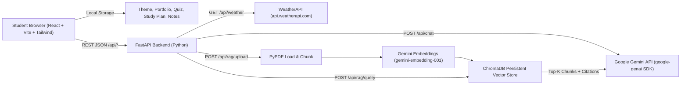

# CampusX — System Architecture

## Overview

CampusX is a full-stack AI Student Hub built with **React + Vite + Tailwind CSS** on the frontend and **Python + FastAPI** on the backend.

## Frontend Architecture (`frontend/src/`)

- `App.jsx`: Top-level state coordinator, theme persistence (`campusx_theme`), `localStorage` synchronization, and backend health polling.
- `components/Sidebar.jsx` & `components/TopBar.jsx`: Responsive navigation drawer, active module indicators, backend health status pill, and dark/light toggle.
- `services/api.js`: Centralized HTTP client targeting `/api/*` (proxied to `127.0.0.1:8000` in development via `vite.config.js`, or `VITE_API_BASE_URL` in production).
- `pages/`:
  - `DashboardPage.jsx`: Welcome hero, productivity KPIs, module launch cards, and API readiness checklist.
  - `PortfolioPage.jsx`: Editable personal portfolio (About, Education, Technical Skills, Languages, Projects, Contact & Social links).
  - `QuizPage.jsx`: 5-question Prompt Engineering MCQ quiz with step navigation, scoring, and answer explanations.
  - `StudyPlannerPage.jsx`: Deadline- and priority-aware multi-day study schedule generator with session completion tracking.
  - `NotesPage.jsx`: Create, edit, pin, filter, search, and delete notes saved in `localStorage`.
  - `WeatherPage.jsx`: City weather lookup via FastAPI with °C/°F unit toggle, loading state, and honest error/missing-key handling.
  - `ChatbotPage.jsx`: Student AI Tutor powered by Google Gemini via FastAPI with temperature slider (`0.1`–`1.0`) and conversation history.
  - `RagPage.jsx`: 7-stage PDF RAG workspace + interactive architecture diagram and business use cases.
  - `SettingsPage.jsx`: Theme preference, live API health diagnostics, and local browser storage reset.

## Backend Architecture (`backend/app/`)

- `config.py`: Loads environment variables from `backend/.env` (`GEMINI_API_KEY`, `GEMINI_MODEL`, `WEATHERAPI_API_KEY`, `CORS_ORIGINS`, `CHROMA_PERSIST_DIR`, `EMBEDDING_MODEL`).
- `routes/health.py`: `GET /api/health` returning server status and boolean integration flags without exposing secrets.
- `routes/weather.py`: `GET /api/weather?city=...` using WeatherAPI (`api.weatherapi.com/v1/current.json`) with 10-minute caching, concurrent deduplication, and invalid-city/quota/network error handling.
- `routes/chat.py`: `POST /api/chat` validating message history and forwarding `temperature` (`0.1`–`1.0`) to Google Gemini.
- `rag/pipeline.py` & `routes/rag.py`: Implements all 7 RAG stages (`upload`, `documents`, `delete`, `query`) backed by `pypdf`, `chromadb`, and `google-genai`.

## Security & Secret Handling

- Third-party API keys (`GEMINI_API_KEY`, `WEATHERAPI_API_KEY`) stay strictly on the Python backend in `.env` (excluded via `.gitignore`).
- No secret keys are bundled into Vite/React or written to browser `localStorage`.
