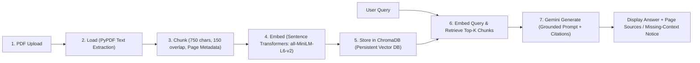

# CampusX — 7-Stage RAG Pipeline & Business Use Cases

## RAG Workflow Diagram

Linear flow summary:

`PDF Upload -> Load -> Chunk -> Embed -> Store in ChromaDB -> User Query -> Retrieve Relevant Chunks -> Gemini Generate -> Answer with Sources`

## Seven Stages in `backend/app/rag/pipeline.py`

1. **LOAD (`load_pdf`)**: Validates `.pdf` file integrity with `pypdf.PdfReader`, extracts text page by page, and rejects empty or image-only PDFs with an actionable error message.
2. **CHUNK (`chunk_pages`)**: Splits each page's text into `750`-character chunks with `150`-character overlap along word boundaries while preserving `document_id`, `filename`, `page_number`, and `chunk_index`.
3. **EMBED (`_get_embedder`)**: Encodes chunks and user queries into normalized dense vectors using `SentenceTransformer("all-MiniLM-L6-v2")`.
4. **STORE (`ingest_pdf`)**: Persists vectors, text chunks, and metadata inside a ChromaDB cosine-similarity collection (`campusx_documents`) under `backend/chroma_db/`.
5. **RETRIEVE (`retrieve`)**: Embeds the student's question and fetches the `top_k` nearest chunks from ChromaDB (optionally scoped to a single PDF), returning cosine similarity scores.
6. **GENERATE (`query`)**: Formats retrieved chunks with file/page headers into a strict grounding system prompt and calls Google Gemini via `google-genai` (`temperature=0.2`), instructing the model to state when the document lacks sufficient information.
7. **DISPLAY (`RagPage.jsx`)**: Renders the grounded answer, highlights low-context warnings when applicable, and lists every retrieved chunk with filename, page number, and similarity percentage.

## Three Real-World Business Use Cases

### 1. Customer Support
- **Scenario**: Support teams and customer help centers answer policy, billing, warranty, and troubleshooting questions from hundreds of product manuals and PDFs.
- **How RAG Helps**: Instead of relying on static FAQ pages or risking LLM hallucinations, RAG retrieves the exact policy clause and generates a clear answer citing the manual page.

### 2. Education
- **Scenario**: Students upload lecture notes, lab manuals, syllabi, and reference textbooks for exam preparation.
- **How RAG Helps**: Students ask targeted questions in natural language and immediately receive explanations grounded in their course material along with exact page numbers to double-check.

### 3. Human Resources (HR)
- **Scenario**: Employees need fast, accurate answers about paid time off, reimbursement rules, travel policies, and onboarding procedures from lengthy employee handbooks.
- **How RAG Helps**: An internal HR assistant retrieves the relevant handbook section and returns consistent, verifiable policy guidance without waiting for manual ticket triage.
